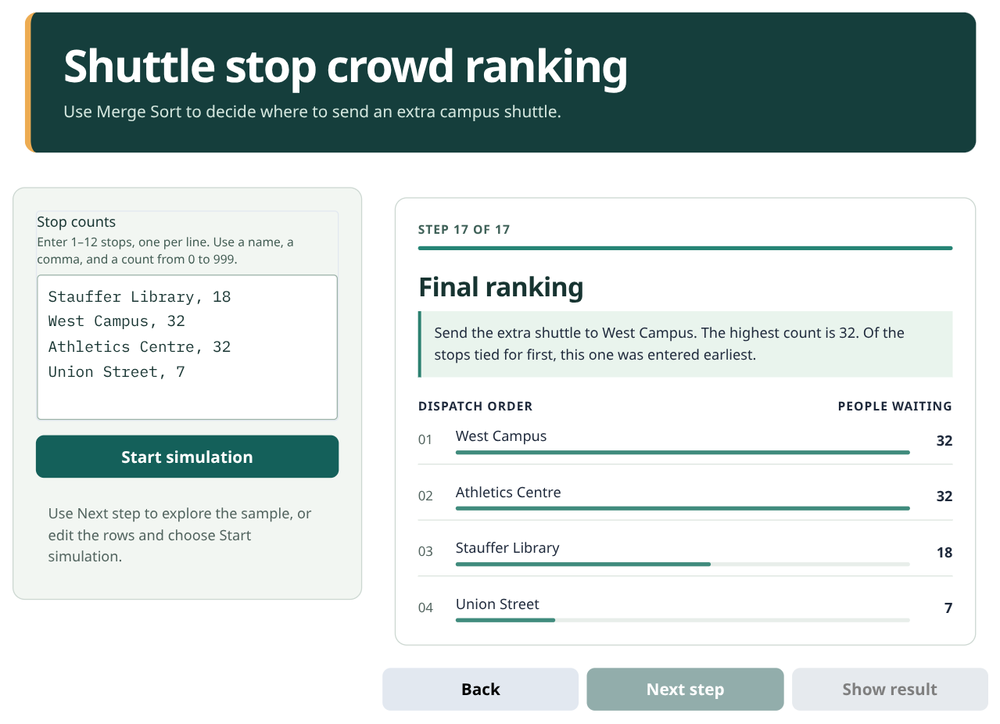
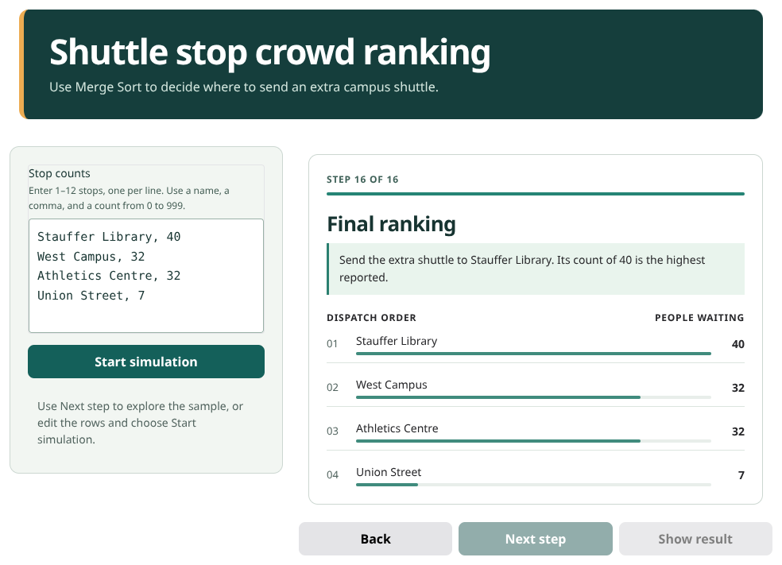
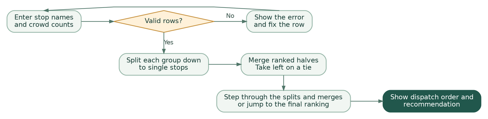

# Shuttle Stop Crowd Ranking

Which stop should get the extra campus shuttle? Enter the number of people waiting at each stop. The app ranks the stops from busiest to quietest and explains where to send the shuttle. The sample counts are fictional and can be replaced.

## Chosen algorithm

Merge Sort fits because each record has one comparable value, the crowd count. It works even if the original list is completely out of order. During a merge, taking the stop from the left group when counts are equal preserves the input order. This gives the dispatcher a predictable tie rule.

## Demo

The example opens on step 1. Press **Next step** to see each split and merge, **Back** to revisit a choice, or **Show result** to skip to dispatch. **Start simulation** applies the rows in the textbox and returns to the beginning.

In the sample, each half produces a stop with 32 people waiting. At step 13, West Campus and Athletics Centre are the two front stops. West Campus came from the left half, so it goes into the merged list first. Athletics Centre is still at the front of the right half for the next comparison.


The completed ranking recommends West Campus. The two equal-length bars show the tie, and the numbered positions show how it was resolved.



The teal cards belong to the left group and the lilac cards belong to the right group. **Front** marks the candidates before the pick. Gold cards marked **Added** show what that step put into the output. A tail step can add several cards because the remaining group is already ranked. [View the first split](docs/01-split.png).

### Stauffer Library at 40

With the original counts, Stauffer Library ranked third with 18 people. Changing just its count to **40** moved it to first and changed the shuttle recommendation to **Stauffer Library**. West Campus and Athletics Centre both stayed at 32, in the order they were entered.



## Problem Breakdown & Computational Thinking

- **Decomposition.** Read each stop and count, validate the rows, split the list into halves, rank each half, and merge the halves. Use the first stop in the completed ranking to make the dispatch decision.
- **Pattern recognition.** Every merge asks the same question. Which of the two front stops has more people waiting? Move that stop to the output. Once a group runs out, its neighbour's remaining stops are already in order.
- **Abstraction.** A stop needs only a name and a whole-number count. The screen shows the two groups and the growing output. Labelled highlights identify the two candidates and the stop just placed. Memory addresses and recursive call frames would add detail without helping the dispatch decision.
- **Algorithm design.** The Gradio textbox supplies a string. Validation converts it into a list of dictionaries. Merge Sort saves a step each time it splits a group, reaches one stop, chooses a stop, or appends the rest of a group. Back and Next step display those saved steps. Show result opens the ranked list and recommendation.



## Data and input rules

Each nonblank line is a stop name, one comma, and the number waiting. For example, `West Campus, 32` becomes the Python dictionary `{"name": "West Campus", "count": 32}`. The name is a string and the count is an integer. The app puts each dictionary into a list in entry order.

- Use 1–12 distinct stops, counts from 0 to 999 inclusive, and names of 1–40 characters. The 12-stop limit keeps the replay manageable. A submission can contain up to 2,000 characters.
- Blank lines are skipped. Extra spaces and capitalization differences are ignored when checking for duplicate names. A name can contain spaces but the single comma on each row is the field separator.
- Counts are estimates for the same point in time. When the highest count is positive, its first-listed stop gets the extra shuttle. If all counts are zero, the shuttle stays on standby.
- The sample is defined in `ranking.py`. All other data comes from the textbox. Editing the rows clears the previous replay.

## How the implementation works

1. In `ranking.py`, `parse_stops` checks each row, converts its count to an integer, and appends the stop to a list. An invalid row produces a message with the original line number.
2. `merge_sort` returns when a group has at most one stop. This is the recursion's base case. For a larger group, it calculates `middle = len(stops) // 2` and calls itself on the slices `stops[:middle]` and `stops[middle:]`.
3. `merge` uses a `while` loop and one index per half. The condition `left_stop["count"] >= right_stop["count"]` picks the busier stop. On a 32-to-32 tie, it takes the left stop. It advances only the chosen side's index. Once one side is empty, it appends the remaining stops.
4. The replay is another list. Each step is a dictionary containing its kind, its explanation, and the lists needed for that screen. For a pick, `merged.copy()` saves the output at that moment. Without the copy, pressing Back could show stops added by a later pick.
5. `dispatch_decision` reads the first ranked stop to make the recommendation. `display.py` draws the steps. In `app.py`, each Gradio button calls an ordinary Python function. For example, Next step adds one to the current index and displays that saved step.

The sort makes O(n log n) crowd comparisons. Each level merges a total of at most n stops, and each split roughly halves the group size. Saving the replay costs extra time and memory. Across all the saved steps, the lists can hold O(n²) references to stop dictionaries.

## Steps to Run

Use Python 3.12. From the folder containing `app.py`, run these commands in Terminal on macOS or Linux.

```bash
python3 -m venv .venv
source .venv/bin/activate
python -m pip install -r requirements.txt
python app.py
```

Open the local URL printed in Terminal. Keep Terminal open while using the app. On Windows, create the environment with `py -3.12 -m venv .venv` and activate it in PowerShell with `.\.venv\Scripts\Activate.ps1`. The last two commands are the same. Gradio 6.32.0 is the only direct dependency for the local app.

## Testing & Verification

In the same activated environment, run the following from the project folder.

```bash
python -m unittest discover -s tests -v
```

All **18 test functions passed** on Python 3.12.14. The table gives expected and observed outcomes. The browser checks also exercised the Gradio controls shown in the screenshots.

| Case | Expected | Observed |
| --- | --- | --- |
| Four sample stops, two tied across halves | West and Athletics first, in entry order | West Campus 32, Athletics Centre 32, Stauffer Library 18, Union Street 7. Dispatch to West Campus. |
| Change just Stauffer Library from 18 to 40 | Stauffer moves to first and the two stops at 32 keep their order | Stauffer Library 40, West Campus 32, Athletics Centre 32, Union Street 7. The edited run finished in 16 steps. |
| One stop, Pier 9 | Return that stop | Three screens showed the input, single stop, and result. Pier gets the shuttle. |
| Gate 0, Pier 0 | Preserve order and keep shuttle available | Gate then Pier, both 0. Standby message shown. |
| Five equal counts, names Z/B/M/C/A | Keep all five in entry order | Z, B, M, C, A. |
| Counts 8/3/0 and 0/3/8 | Both yield 8/3/0 | Gate 8, Pier 3, Hall 0 in both runs. |
| Twelve stops entered least busy first | Keep all records and reverse the counts | All 12 returned in order from 12 through 1. |
| Count of -2 on the second row | Identify line 2 and the allowed range | “Line 2 needs a whole number from 0 to 999.” [Screenshot](docs/04-input-error.png) |
| Same stop twice using different spacing and case | Report both lines | Line 3 identified as a repeat of line 1. |
| Blank input, bad commas, missing fields, decimals, 1,000 people, or 13 stops | Reject the invalid input | Each produced the expected correction message. Valid boundary counts 0 and 999 were accepted. |
| All lists of lengths 1–6 with counts drawn from 0, 1, 2 | Match an independent stable reference, including tied names | All 1,092 lists matched. Python's built-in sort appears only in the test file as the reference. |

The browser run visited all 17 sample frames. It also checked Back and Show result, recovery after the invalid count, a fresh tab with its own replay, and long names at widths of 320, 390 and 768 pixels.

The single-file Gradio-Lite build also ran on its own in a fresh Chromium iframe. The browser test visited all 17 frames, checked the tie and Back button, corrected a negative count, and confirmed the changed-count, all-zero and single-stop decisions. [See the Gradio-Lite sample result](docs/05-gradio-lite.png).

## Hugging Face Link

[Open the shuttle ranking app on Hugging Face](https://huggingface.co/spaces/nyalpathak/cisc121-shuttle-ranking) · [View the project on GitHub](https://github.com/nyalpathak/cisc121-shuttle-ranking)

The Space uses the free Static SDK with Gradio-Lite 5.45.0. It runs the same Python functions and Gradio controls in the visitor’s browser. The first visit downloads Python and the interface, so allow a little time for the input box to appear.

**To deploy or update the Space**, upload the supplied `index.html` to its top-level Files tab, replacing the starter page, and commit to `main`. The Space README must select `sdk: static`. The default entry file is `index.html`. If the Python or CSS changes, run `python build_space.py` to regenerate that file. The builder embeds the project sources and pins four compatible Python packages for the browser. Each visit needs internet access to load Gradio and Python packages.

**To check a deployment**, choose **Show result** with the original sample. West Campus should come first with 32. Then edit Stauffer Library from 18 to 40, choose **Start simulation**, and choose **Show result** again. Stauffer Library should now come first with 40. A private project requires grader access on each platform.

## Author & AI Acknowledgment

**Student:** Nyal, CISC 121, Queen’s University.

**AI assistance.** OpenAI ChatGPT helped choose the scenario and tie rule, draft and revise the Python and Gradio code, prepare the tests, README and flowchart, and package the app for the Space. For this revision it rewrote the stop and replay data using dictionaries and checked the updated code. I tested the live app by changing Stauffer Library from 18 to 40 and checking that it moved into first place. I revised the naming of functions. 

**Sources.** The course's *CISC 121 Project Guidelines*, problem 2, and the supplied *Project README template* guided the scope and structure. The CISC 121 *Makeup Quiz Review* covers dictionaries on slide 38, functions and recursion on slides 40–42, and the two-index Merge Sort on slides 67–68. The shuttle problem uses descending order. The interface and browser deployment use Gradio, Gradio-Lite and Hugging Face Static Spaces. [Gradio session state](https://www.gradio.app/guides/state-in-blocks) · [Gradio-Lite](https://huggingface.co/blog/gradio-lite) · [Hugging Face Static Spaces](https://huggingface.co/docs/hub/spaces-sdks-static).
