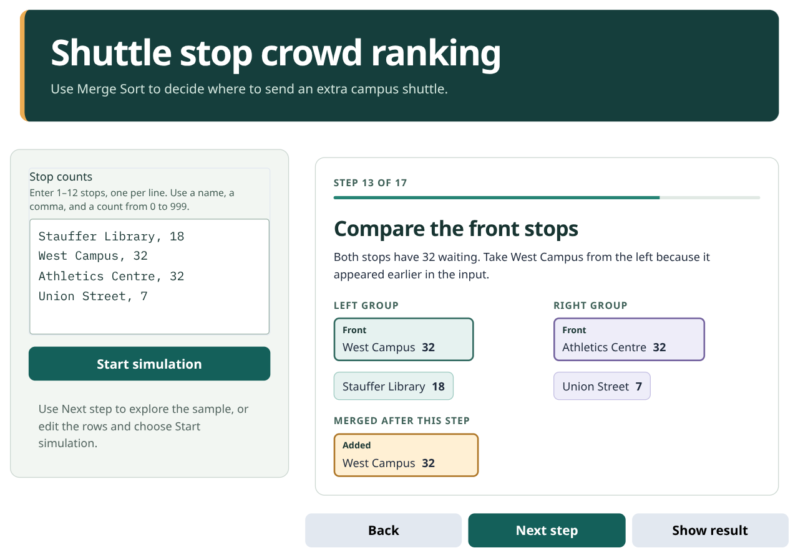

# Shuttle Stop Crowd Ranking

Which stop should get the extra campus shuttle? Enter the number of people waiting at each stop. The app ranks the stops from busiest to quietest and explains where to send the shuttle. The sample counts are fictional and can be replaced.

## Chosen algorithm

Merge Sort fits because each record has one comparable value, the crowd count. It works even if the original list is completely out of order. During a merge, taking the stop from the left group when counts are equal preserves the input order. This gives the dispatcher a predictable tie rule.

## Demo

The example opens on step 1. Press **Next step** to see each split and merge, **Back** to revisit a choice, or **Show result** to skip to dispatch. **Start simulation** applies the rows in the textbox and returns to the beginning.

In the sample, each half produces a stop with 32 people waiting. At step 13, West Campus and Athletics Centre are the two front stops. West Campus came from the left half, so it goes into the merged list first. Athletics Centre is still at the front of the right half for the next comparison.



The completed ranking recommends West Campus. The two equal-length bars show the tie, and the numbered positions show how it was resolved.


The teal cards belong to the left group and the lilac cards belong to the right group. **Front** marks the candidates before the pick. Gold cards marked **Added** show what that step put into the output. A tail step can add several cards because the remaining group is already ranked. [View the first split](docs/01-split.png).

## Problem Breakdown & Computational Thinking

- **Decomposition.** Read each stop and count, validate the rows, split the list into halves, rank each half, and merge the halves. Use the first stop in the completed ranking to make the dispatch decision.
- **Pattern recognition.** Every merge asks the same question. Which of the two front stops has more people waiting? Move that stop to the output. Once a group runs out, its neighbour's remaining stops are already in order.
- **Abstraction.** A stop needs only a name and a whole-number count. The screen shows the two groups and the growing output. Labelled highlights identify the two candidates and the stop just placed. Memory addresses and recursive call frames would add detail without helping the dispatch decision.
- **Algorithm design.** The Gradio textbox supplies a string. Validation converts it into a list of stop records. Merge Sort records the actual splits and merges. Back and Next step replay these snapshots, and Show result opens the ranked list and recommendation.


## Data and input rules

Each nonblank line is a stop name, one comma, and the number waiting. The app stores the name as a Python string and the count as an integer in a `Stop` record. A Python list preserves entry order. Start with any ordering.

- Use 1–12 distinct stops, counts from 0 to 999 inclusive, and names of 1–40 characters. The 12-stop limit keeps the replay manageable. A submission can contain up to 2,000 characters.
- Blank lines are skipped. Extra spaces and capitalization differences are ignored when checking for duplicate names. A name can contain spaces but the single comma on each row is the field separator.
- Counts are estimates for the same point in time. When the highest count is positive, its first-listed stop gets the extra shuttle. If all counts are zero, the shuttle stays on standby.
- The sample is defined in `ranking.py`. All other data comes from the textbox. Editing the rows clears the previous replay.

## How the implementation works

1. `parse_stops` checks each row and reports its original line number if it needs correction.
2. `merge_sort` finds the middle with `len(stops) // 2`. It returns when a group has at most one stop. Otherwise, it calls itself on both halves.
3. `merge` walks the two ranked halves with separate indices. The comparison `left_stop.count >= right_stop.count` picks the busier front stop and gives the left stop priority on a tie. Only the index for the chosen stop advances.
4. Each split, single-stop group, pick, and tail creates a `Step`. The merge copies its growing output so later choices cannot change an earlier screen. Gradio saves the steps and current position for each session.
5. `dispatch_decision` reads the completed ranking. `display.py` draws the saved steps and final counts. Going back reuses the saved step.

The sort makes at most O(n log n) crowd comparisons. Each level merges a total of n stops, and each split roughly halves the group size. Saving the remaining groups and partial output for every pick adds overhead. The replay can store O(n²) record references across its snapshots.

## Steps to Run

Use Python 3.12. From the folder containing `app.py`, run these commands in Terminal on macOS or Linux.

```bash
python3 -m venv .venv
source .venv/bin/activate
python -m pip install -r requirements.txt
python app.py
```

Open the local URL printed in Terminal. Keep Terminal open while using the app. On Windows, create the environment with `py -3.12 -m venv .venv` and activate it in PowerShell with `.\.venv\Scripts\Activate.ps1`. The last two commands are the same. The only direct dependency is Gradio 6.32.0.

## Testing & Verification

In the same activated environment, run the following from the project folder.

```bash
python -m unittest discover -s tests -v
```

All **17 test methods passed** on Python 3.12.14. The table gives expected and observed outcomes. A separate browser run exercised the real Gradio controls and produced the screenshots.

| Case | Expected | Observed |
| --- | --- | --- |
| Four sample stops, two tied across halves | West and Athletics first, in entry order | West Campus 32, Athletics Centre 32, Stauffer Library 18, Union Street 7. Dispatch to West Campus. |
| One stop, Pier 9 | Return that stop | Three screens showed the input, single stop, and result. Pier gets the shuttle. |
| Gate 0, Pier 0 | Preserve order and keep shuttle available | Gate then Pier, both 0. Standby message shown. |
| Five equal counts, names Z/B/M/C/A | Keep all five in entry order | Z, B, M, C, A. |
| Counts 8/3/0 and 0/3/8 | Both yield 8/3/0 | Gate 8, Pier 3, Hall 0 in both runs. |
| Twelve stops entered least busy first | Keep all records and reverse the counts | All 12 returned in order from 12 through 1. |
| Count of -2 on the second row | Identify line 2 and the allowed range | “Line 2 needs a whole number from 0 to 999.” [Screenshot](docs/04-input-error.png) |
| Same stop twice using different spacing and case | Report both lines | Line 3 identified as a repeat of line 1. |
| Blank input, bad commas, missing fields, decimals, 1,000 people, or 13 stops | Reject the invalid input | Each produced the expected correction message. Valid boundary counts 0 and 999 were accepted. |
| All lists of lengths 1–6 with counts drawn from 0, 1, 2 | Match an independent stable reference, including tied names | All 1,092 lists matched. Python's built-in sort appears only in the test file as the reference. |

The browser run visited all 17 sample frames. It also checked Back and Show result, recovery after the invalid count, a fresh tab with its own replay, and long names at widths of 320, 390 and 768 pixels.

## Hugging Face Link

**Live Space:** Pending deployment. Replace this line with the tested Space URL before submitting.

Private source repository on GitHub. [nyalpathak/cisc121-shuttle-ranking](https://github.com/nyalpathak/cisc121-shuttle-ranking)

Publish the contents of this folder at the root of a Gradio Space. The settings at the top of this README select Python 3.12, Gradio 6.32.0, and `app.py`. Open the deployed app, step through a comparison, and check the sample result before copying its URL to OnQ.

## Author & AI Acknowledgment

**Student:** Nyal, CISC 121, Queen’s University.

**AI assistance:** OpenAI ChatGPT (Codex) helped select the scenario and tie rule, drafted the Python and Gradio code, wrote and ran the tests, captured screenshots from the running app, and drafted the flowchart and this README. The program records its own Merge Sort operations. The sample crowd counts are fictional.

**Sources:** The course's *CISC 121 Project Guidelines*, problem 2, and the supplied *Project README template* guided the scope and structure. The interface uses Gradio session state and the deployment settings follow Hugging Face's guide. [Gradio session state](https://gradio.app/guides/state-in-blocks) · [Gradio Spaces](https://huggingface.co/docs/hub/spaces-sdks-gradio) · [Space configuration](https://huggingface.co/docs/hub/spaces-config-reference).
